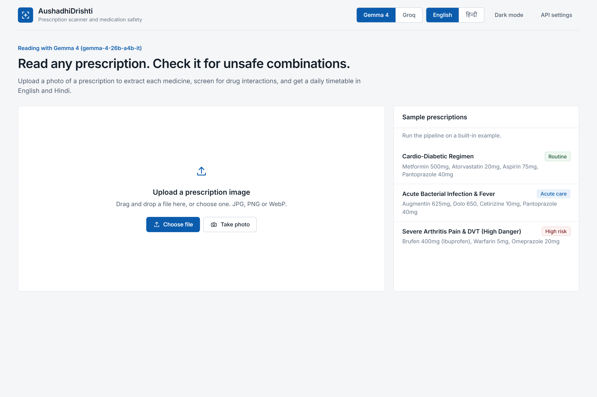
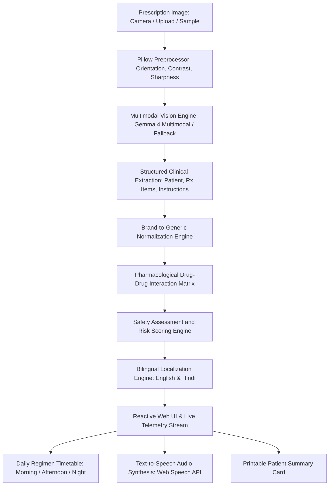

<div align="center">

# AushadhiDrishti (औषधि दृष्टि)

### Multimodal Artificial Intelligence Prescription Scanner and Clinical Medication Safety Engine

[](LICENSE)
[](https://www.python.org/)
[](https://fastapi.tiangolo.com/)
[](https://ai.google.dev/)
[](#bilingual-accessibility-and-speech)

</div>

---

## Table of Contents

- [Overview](#overview)
- [Application Screenshots](#application-screenshots)
- [Clinical Motivation](#clinical-motivation)
- [Core Architecture](#core-architecture)
- [Key Capabilities](#key-capabilities)
- [Technology Stack](#technology-stack)
- [Directory Structure](#directory-structure)
- [Installation and Setup](#installation-and-setup)
- [Configuration](#configuration)
- [Running the Application](#running-the-application)
- [Evaluation Scenarios](#evaluation-scenarios)
- [API Reference](#api-reference)
- [Clinical Safety Disclaimer](#clinical-safety-disclaimer)

---

## Overview

AushadhiDrishti (औषधि दृष्टि) is an end-to-end clinical workflow system designed to digitize handwritten medical prescriptions, identify pharmaceutical compounds, screen for contraindications and drug-drug interactions, and convert clinical instructions into patient-friendly daily regimens in both English and Hindi.

The platform integrates computer vision, multimodal reasoning powered by Gemma 4, and an automated clinical pharmacology matrix. Designed for real-world clinical and patient environments, it supports camera captures, mobile uploads, speech synthesis (Text-to-Speech) for low-literacy or visually impaired patients, and printable medical schedules.

---

## Application Screenshots

### 1. Prescription Ingestion and Demonstration Presets
The clean interface allows users to upload local prescription images, take direct camera snapshots, or load pre-configured clinical evaluation samples.

<p align="center">
  
</p>

### 2. Real-Time Pipeline Telemetry and Preprocessing
As images are submitted, the backend streams live progress events detailing upload validation, dynamic contrast and sharpness enhancement, and Gemma 4 multimodal neural extraction with an active elapsed timer.

<p align="center">
  
  
</p>

### 3. Clinical Extraction, Interaction Screening, and Daily Timetable
Once extraction completes, the application displays an enhanced scan alongside extracted patient metadata, an overall safety score, plain-language patient advice with bilingual voice synthesis (TTS), pharmacological interaction alerts, and a structured three-slot daily schedule (Morning, Afternoon, Night).

<p align="center">
  
</p>

---

## Clinical Motivation

Preventable adverse drug events (ADEs) and medication errors remain among the leading causes of morbidity worldwide:

1. **Illegible Handwriting**: Unclear handwritten prescriptions cause misinterpretation of drug names, dosages, and administration intervals.
2. **Brand-Name Ambiguity**: In India and emerging markets, hundreds of commercial brand names map to the same generic molecules, causing accidental double-dosing or unrecognized contraindications.
3. **Complex Polypharmacy**: Patients undergoing concurrent treatments for chronic and acute conditions often receive conflicting medications without unified interaction screening.
4. **Linguistic and Literacy Barriers**: Medical instructions written in English are frequently misunderstood by non-English-speaking populations, leading to improper timing (such as consuming proton-pump inhibitors after meals instead of on an empty stomach).

AushadhiDrishti addresses these challenges directly at the point of patient care.

---

## Core Architecture



### Pipeline Progression

1. **Image Ingestion and Normalization**: The raw image is processed through Pillow to correct EXIF rotation, balance dynamic contrast, enhance ink-stroke sharpness, and bound image dimensions for neural processing.
2. **Multimodal Clinical Extraction**: The enhanced prescription is processed by Gemma 4 multimodal vision endpoints. The model transcribes patient data, prescribed drugs, dosages, frequencies, and durations into structured JSON.
3. **Brand-to-Generic Resolution**: Extracted brand names (e.g., Augmentin, Dolo, Brufen) are mapped to standard generic entities (e.g., Amoxicillin-Clavulanic Acid, Paracetamol, Ibuprofen).
4. **Interaction and Safety Screening**: The normalized regimen is evaluated against the clinical interaction database, scoring risks across three distinct clinical severity tiers: Contraindicated, Major, and Moderate.
5. **Bilingual Synthesis and Output**: Structured summaries, food-relative administration guidelines, warning advisories, and three-slot daily schedules (Morning, Afternoon, Night) are rendered in real time.

---

## Key Capabilities

### Multimodal Vision and Handwriting Recognition
- Deciphers non-standard handwriting and clinical shorthand (e.g., "1-0-1", "OD", "BD", "TDS", "SOS", "ac", "pc").
- Powered by Gemma 4 multimodal vision architecture for zero-shot clinical document reasoning.
- Offline heuristic fallback engine for uninterrupted demonstration even without active network or API access.

### Contrast and Stroke Preprocessing
- Automatic orientation correction from mobile camera EXIF metadata.
- Adaptive luminance balancing and unsharp-masking to clarify faded ballpoint and fountain pen strokes against colored or shadowed prescription pads.

### Pharmacology Engine and Safety Matrix
- Verified drug catalog mapping Indian commercial brand names, international generics, therapeutic classes, and indications.
- Multi-tier interaction screening:
  - **Contraindicated**: Lethal or life-threatening combinations (e.g., Warfarin + NSAIDs causing major hemorrhage).
  - **Major**: Severe interactions requiring medical dosage adjustment or close monitoring.
  - **Moderate**: Mild interactions requiring spacing or timing adjustments.
- Quantitative safety index calculated per prescription.

### Bilingual Accessibility and Speech
- Full dual-language interface (English default, with real-time Hindi translation for all fields).
- Integrated Web Speech API for voice readout in both Hindi and English.
- Formatted daily medication schedule organized by time of day with meal indicators.
- Printable, high-contrast summary cards exportable directly to PDF.

### Live Telemetry Streaming
- Server-Sent Events / NDJSON streaming for transparent progress updates:
  - Stage 1: Upload received
  - Stage 2: Image contrast enhancement
  - Stage 3: Neural vision processing with live elapsed timer
  - Stage 4: Clinical interaction and safety analysis
  - Stage 5: Final report compilation

---

## Technology Stack

- **Backend Runtime**: Python 3.10+
- **API Framework**: FastAPI, Uvicorn
- **HTTP Client**: HTTPX (asynchronous client with connection pooling and retry handling)
- **Image Processing**: Pillow (PIL)
- **Data Validation**: Pydantic v2
- **Frontend Architecture**: Modern Vanilla JavaScript (ES6+), HTML5 Semantic markup, Vanilla CSS (design tokens, glassmorphism, responsive grid)
- **Audio Synthesis**: Native Browser Web Speech API (SpeechSynthesis)
- **Data Formats**: JSON, NDJSON (application/x-ndjson)

---

## Directory Structure

```
AushadhiDrishti/
├── app.py                      # FastAPI application entrypoint and route handlers
├── requirements.txt            # Python dependencies
├── run.bat                     # Windows quick-launch script
├── .env.example                # Template for environment configuration
├── .gitignore                  # Git exclusions (environment files, bytecode, caches)
├── README.md                   # Project documentation
├── AppScreenShot/              # Interface demonstration screenshots
├── data/
│   ├── drug_database.json      # Comprehensive drug catalog and generic mappings
│   ├── interactions.json       # Clinical interaction rules and severity matrices
│   └── *.jpg                   # Demonstration reference images
├── services/
│   ├── __init__.py
│   ├── preprocessor.py         # Pillow contrast and image enhancement pipeline
│   ├── gemma_client.py         # Multimodal API client and offline fallback engine
│   └── interaction_engine.py   # Clinical rule matcher and safety scoring
└── static/
    ├── index.html              # Main single-page web dashboard
    ├── css/
    │   └── style.css           # Design system, responsive layouts, color tokens
    ├── js/
    │   └── app.js              # Application logic, streaming consumer, TTS, i18n
    └── samples/                # Generated sample prescription image assets
```

---

## Installation and Setup

### 1. Prerequisites
- Python 3.10, 3.11, 3.12, or 3.13 installed and added to the system PATH.
- Git installed on your local machine.
- A modern web browser (Google Chrome, Microsoft Edge, Mozilla Firefox, or Safari).

### 2. Clone the Repository
```bash
git clone https://github.com/sillypari/AushadhiDrishti.git
cd AushadhiDrishti
```

### 3. Create a Virtual Environment (Recommended)
```bash
# On Windows
python -m venv venv
venv\Scripts\activate

# On Linux / macOS
python3 -m venv venv
source venv/bin/activate
```

### 4. Install Dependencies
```bash
pip install -r requirements.txt
```

---

## Configuration

Copy the example environment file to create your local `.env`:

```bash
cp .env.example .env
```

Edit `.env` to configure your API parameters:

```env
# Google AI Studio / Gemma Multimodal API Configuration
GEMMA_API_KEY=your_google_ai_studio_api_key_here
GEMMA_API_BASE=https://generativelanguage.googleapis.com/v1beta
GEMMA_MODEL=gemma-4-26b-a4b-it

# Demonstration Fallback Mode (true enables offline heuristics if API key is blank)
FALLBACK_MODE=true
```

*Note: The platform includes a built-in offline demonstration engine. If no API keys are configured, the application automatically runs in demonstration mode using authentic clinical test fixtures.*

---

## Running the Application

### Method A: Direct Command Line
```bash
python -m uvicorn app:app --host 127.0.0.1 --port 8000 --reload
```

### Method B: Windows Quick Launch
Double-click `run.bat` or run:
```bat
run.bat
```
This script checks required dependencies, launches the server, and automatically opens your default browser at `http://127.0.0.1:8000`.

---

## Evaluation Scenarios

The web interface includes built-in test fixtures for immediate evaluation:

1. **Cardio-Diabetic Regimen (Safe / Monitored)**
   - **Medications**: Metformin 500mg, Atorvastatin 20mg, Aspirin 75mg, Pantoprazole 40mg.
   - **Clinical Focus**: Chronic metabolic management, empty-stomach proton-pump inhibitor timing, and mild antiplatelet monitoring.

2. **Acute Bacterial Infection and Fever (Acute Care)**
   - **Medications**: Augmentin 625mg (Amoxicillin + Clavulanic Acid), Dolo 650 (Paracetamol), Cetirizine 10mg, Pantoprazole 40mg.
   - **Clinical Focus**: Adherence to full antibiotic course duration, antipyretic timing, and symptom management.

3. **Severe Arthritis Pain and DVT (Critical Risk Demonstration)**
   - **Medications**: Brufen 400mg (Ibuprofen), Warfarin 5mg, Omeprazole 20mg.
   - **Clinical Focus**: Highlights a contraindicated drug-drug interaction. Flagged for severe hemorrhagic risk caused by concurrent anticoagulant and non-steroidal anti-inflammatory administration.

---

## API Reference

### Health and Status
- `GET /api/health`: Returns current backend status, active model identifier, and database counts.

### Configuration Management
- `GET /api/config`: Retrieves public configuration details (keys are masked).
- `POST /api/config`: Updates endpoints or credentials at runtime.
- `POST /api/config/test`: Performs a live latency ping against the selected model endpoint.

### Prescriptions and Analysis
- `GET /api/samples`: Returns metadata and scenarios for built-in sample prescriptions.
- `POST /api/analyze/stream`: Accepts multipart file upload; streams real-time NDJSON progress events through extraction, interaction checking, and timetable generation.
- `POST /api/analyze-sample/{preset_id}/stream`: Runs the streaming analysis pipeline for a specified built-in sample prescription.
- `POST /api/analyze`: Non-streaming synchronous analysis endpoint for uploaded prescription images.
- `POST /api/analyze-sample/{preset_id}`: Non-streaming synchronous analysis endpoint for built-in samples.

### Pharmacological Catalog
- `GET /api/drugs`: Returns the verified drug dictionary including indications, contraindications, and brand-name cross references.

---

## Clinical Safety Disclaimer

AushadhiDrishti is designed as an assistive medical technology demonstration and research prototype. It does not provide certified medical diagnoses, clinical prescriptions, or binding treatment plans. Automated outputs must be verified by a licensed healthcare professional before administering or altering any medication regimen.
