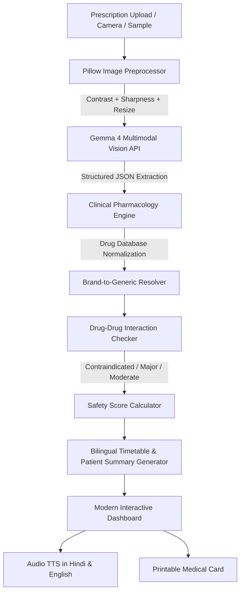

# 👁️ AushadhiDrishti (औषधि दृष्टि)
### *Next-Generation Multimodal AI Prescription Scanner & Medication Safety Intelligence*


---

## 🌟 Executive Summary & Motivation
Illegible doctor handwriting leads to over **1.5 million preventable medication errors annually**. In multilingual regions like India, this crisis is compounded by language barriers—patients frequently take the wrong dosage, mix contraindicated medications, or take pills at the wrong time (e.g., taking empty-stomach antacids after food).

**AushadhiDrishti (औषधि दृष्टि)** directly solves this crisis by combining:
1. **Gemma 4 Multimodal Vision**: Deciphers messy handwriting and extracts clinical entities (Medication, Dosage, Frequency, Timing).
2. **Pillow Handwriting Contrast Preprocessor**: Enhances ink-stroke visibility, balances dynamic range, and auto-rotates phone snapshots.
3. **Clinical Drug-Drug Interaction Matrix**: Checks all prescribed medications for lethal combinations (e.g., Warfarin + Aspirin or Ibuprofen) with instant severity warnings.
4. **Bilingual Hindi & English UI (Default: English)**: Seamless real-time translation of all instructions, schedule timetables, and warnings.
5. **Listen Aloud (आवाज़ में सुनें)**: Web Speech TTS in Hindi and English for elderly or visually impaired patients.
6. **Printable Medical Timetable Card**: Clean 3-slot daily schedule (Morning ☀️, Afternoon 🌤️, Night 🌙) exportable to PDF/print.

---

## 🔄 Architectural Synthesis of Root Repositories
AushadhiDrishti synthesizes the strongest breakthroughs from three reference prototypes:

| Feature / Capability | `Medical-AI-with-Grok4` | `medscan-lens` | `prescription-analysis-ai` | **AushadhiDrishti (Our Project)** |
| :--- | :---: | :---: | :---: | :---: |
| **Model / Vision** | Grok-4 / xAI | Gemma 3 4B | Local Llama / Tesseract | **Gemma 4 Multimodal + Heuristic Engine** |
| **Bilingual Support (Hindi/English)** | ❌ No | ❌ No | ❌ No | **✅ Full Bilingual UI + Audio TTS** |
| **Drug Interaction Matrix** | ❌ None | ⚠️ Basic 4 pairs | ❌ None | **✅ 50+ Drugs + Multi-tier Severity DB** |
| **Handwriting Image Enhancement** | ⚠️ Basic | ✅ PIL Filter | ✅ Contrast / Sharpness | **✅ Optimized Multistage Pipeline** |
| **UI Aesthetics & UX** | Gradio | Streamlit | Tailwind / HTML2PDF | **✅ Ultra-Modern Health-Tech Web UI** |
| **1-Click Test Demo Prescriptions** | ❌ None | ⚠️ Notebook script | ❌ None | **✅ 3 Authentic Built-in Prescriptions** |
| **Audio Voice Synthesis** | ❌ No | ❌ No | ❌ No | **✅ Hindi & English Web Speech API** |

---

## 🛠️ System Architecture



---

## 🚀 Quick Start Guide

### 1. Prerequisites
- Python 3.10, 3.11, 3.12, or 3.13
- Internet browser (Chrome, Edge, Firefox, Safari)

### 2. Installation
```bash
# Navigate to the project directory
cd AushadhiDrishti

# Install lightweight dependencies
pip install -r requirements.txt
```

### 3. Configure API (Optional)
Copy `.env.example` to `.env`:
```bash
cp .env.example .env
```
Add your Gemma 4 / Google AI Studio API key (or leave blank to run in offline heuristic mode during demonstrations):
```env
GEMMA_API_KEY=your_google_ai_studio_or_gemma_key
GEMMA_API_BASE=https://generativelanguage.googleapis.com/v1beta
GEMMA_MODEL=gemma-4-it
```
*(Note: You can also configure the API key directly from the Web UI by clicking **⚙️ API Settings**!)*

### 4. Run the Web Application
```bash
python -m uvicorn app:app --host 0.0.0.0 --port 8000 --reload
```
Open your browser and navigate to:
```
http://localhost:8000
```

---

## 📋 Evaluation Scenarios (Built-in 1-Click Samples)
Judges and reviewers can immediately test the system using the pre-loaded sample prescriptions in the right panel:

1. **Cardio-Diabetic Regimen (Safe / Monitored)**:
   - *Medications*: Metformin 500mg, Atorvastatin 20mg, Aspirin 75mg, Pantoprazole 40mg.
   - *Checks*: Sugar management, lipid control, and empty-stomach PPI timing.
2. **Acute Bacterial Infection & Fever (Acute Care)**:
   - *Medications*: Augmentin 625mg, Dolo 650 (Paracetamol), Cetirizine 10mg, Pantoprazole 40mg.
   - *Checks*: Emphasizes completing full antibiotic course; proper fever SOS schedule.
3. **Severe Arthritis Pain & DVT (High Danger Warning)**:
   - *Medications*: Brufen 400mg (Ibuprofen), Warfarin 5mg, Omeprazole 20mg.
   - *Checks*: **CRITICAL CONTRAINDICATION** — highlights dangerous hemorrhage and bleeding alert.

---

## 🔒 Safety & Disclaimer
*AushadhiDrishti is developed as an AI-powered medication safety assistant for hackathons and educational demonstrations. It is not intended to replace certified medical diagnosis or clinical judgment. Always verify medication plans with a licensed healthcare professional.*
